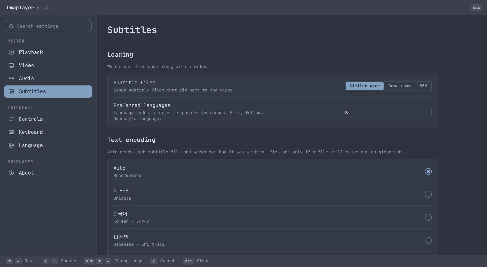
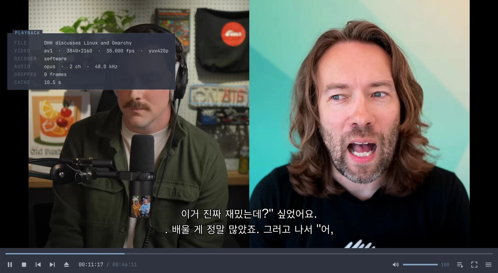
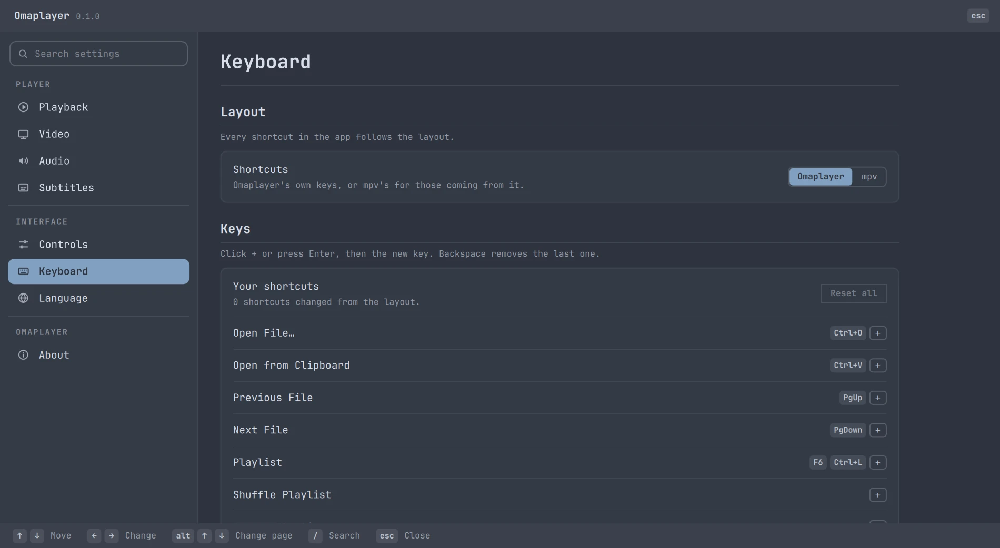
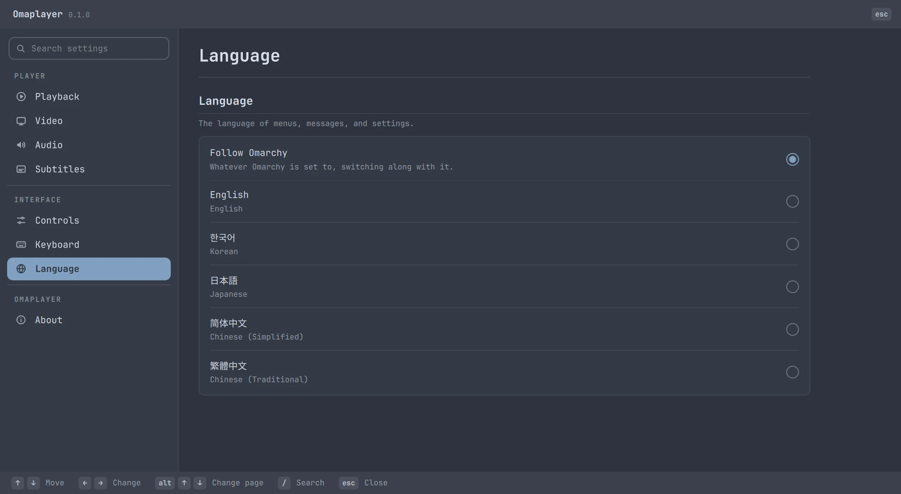

<div align="center">


# Omaplayer

<picture>
  <source media="(prefers-color-scheme: dark)" srcset="docs/hero-dark.svg">
  
</picture>

<br><br>


</div>

## Why Omaplayer

Haruna and Celluloid are decent, but they don't look like Omarchy. Plain mpv is
fast but bare. And PotPlayer, with the best interface and keys any player ever
had, doesn't run here.

**So Omaplayer takes PotPlayer's hands, gives it Omarchy's face, and runs on mpv.**

- **Your hands already know it.** PotPlayer's keys, the right-click master menu,
  the docked bar, Tab for info, and the wheel for volume. The Linux classics
  (`Ctrl+,`, `Ctrl+Q`, `F11`) work too, and every key can be rebound.
- **Your theme is the skin.** Every color comes from your Omarchy theme, and it
  changes the moment you switch themes. Clean, keyboard-first, no chrome to spare.
- **mpv speed, no compromise.** Hardware decoding, video drawn straight into the
  window, folder playlists, resume where you left off, and YouTube by URL.
- **Subtitles never come out garbled.** Any encoding, any language. See below.
- **Speaks your language:** English, 한국어, 日本語, 简体中文, 繁體中文.

## Install

```sh
curl -fsSL https://raw.githubusercontent.com/verified-human-42/omaplayer/main/install.sh | bash
```

It builds the latest release as a regular pacman package, and Omaplayer shows up
in the launcher. Run it again to update; `sudo pacman -R omaplayer` removes it.
For the latest from `main`, add `-s -- --git`. A prebuilt package is on every
[release](https://github.com/verified-human-42/omaplayer/releases/latest).

## Smart subtitles

Most subtitle files were saved on Windows in an old codepage, and players that
guess the encoding get them wrong. Omaplayer reads each file and picks the
encoding whose text reads like real language: Korean, Japanese, Chinese,
Cyrillic, Greek, Hebrew, Arabic, Turkish, European, and more. It's tested on
70+ real lines down to a single word, with no hint.

- **SMI files get every language.** Korean and English classes become separate
  tracks instead of one jumbled track.
- **Stream captions in your language**, the site's own translations included.
- **Drop a subtitle on the window** to add it.

한글 자막 지원됩니다 · 日本語字幕に対応 · 支持简体中文字幕 · 支援繁體中文字幕

<table>
  <tr>
    <td></td>
    <td></td>
  </tr>
  <tr>
    <td></td>
    <td></td>
  </tr>
</table>

## Keys

<details>
<summary>The default layout (an mpv layout is one click away in Settings)</summary>

| | |
|---|---|
| `Space` | Play / pause |
| `←` `→` / `Ctrl+←` `Ctrl+→` | Seek 5 s / 30 s |
| `↑` `↓` · `M` | Volume · mute |
| `PgUp` `PgDn` | Previous / next file |
| `D` `F` | Previous / next frame |
| `X` `C` `Z` | Slower / faster / normal speed |
| `,` `.` · `Alt+H` | Subtitles earlier / later · show or hide |
| `Enter` / `F11` · `Esc` | Fullscreen · leave it |
| `Tab` | Playback info |
| `F6` / `Ctrl+L` | Playlist |
| `F5` / `Ctrl+,` | Settings |
| `Ctrl+O` · `Ctrl+V` | Open a file · open a path or URL from the clipboard |
| `?` | Every shortcut |
| `Q` / `Ctrl+Q` | Quit |

Mouse: click to pause, double-click for fullscreen, wheel for volume,
right-click for the menu, and click the clock to show time remaining.

</details>

## Build

```sh
bin/build      # build/omaplayer
bin/test       # the test suite
bin/install    # install from this checkout
```

C++ and Qt Quick around libmpv. See [`AGENTS.md`](AGENTS.md) for how it fits together.

## License

GPL-3.0. Parts adapted from Omacut and Monologue are MIT; see [`NOTICE`](NOTICE).
Screenshots show [“DHH discusses Linux and Omarchy”](https://www.youtube.com/watch?v=zikJTpJgzzo)
by typecraft, streamed from YouTube.
