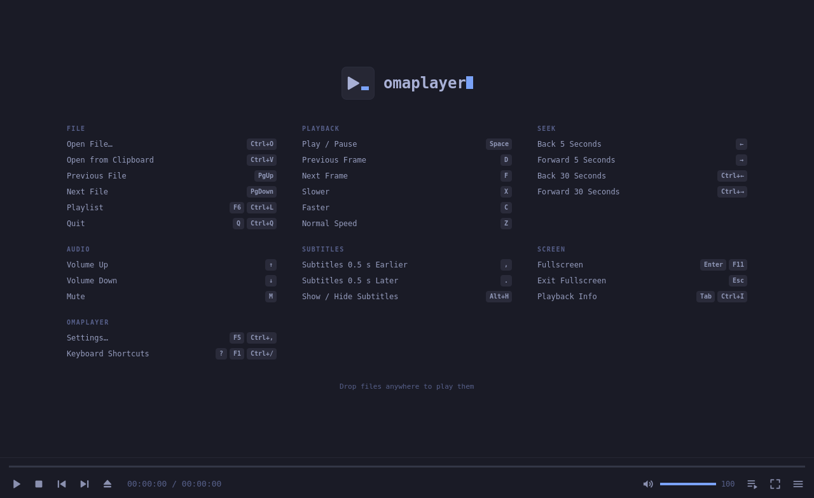

# Omaplayer

**Feels like PotPlayer. Looks like Omarchy. Runs on mpv.**



Omaplayer is a media player for Omarchy that works the way PotPlayer does: the
same keys, the same right-click menu, the same Tab info and control panel.
It's built on mpv, so it plays everything and stays fast, and it follows your
Omarchy theme live.

- **Your hands already know it.** Space, arrows, `Ctrl`+arrows, `PgUp`/`PgDn`,
  `D`/`F` frame stepping, `X`/`C`/`Z` speed, `,`/`.` subtitle sync, `Enter`
  fullscreen, `Tab` info, `F5` settings, `F6` playlist, plus the Linux
  standards (`Ctrl+,` settings, `Ctrl+Q`, `F11`). Prefer mpv's keys? Switch
  layouts in Settings.
- **Your theme is the skin.** Colours come from the current Omarchy theme and
  change the moment you switch themes. Corners follow Hyprland.
- **mpv underneath, with nothing in the way.** Video is drawn straight into the
  window, hardware decoding is on, and startup is measured.
- **The folder is the playlist.** Open one episode and the rest of the season
  queues around it, in natural order.
- **Picks up where you left off**, per file.
- **Subtitles that never come out as gibberish.** See below.
- **Speaks your language**: English, 한국어, 日本語, 简体中文, and 繁體中文, following
  Omarchy or picked in Settings.

## Smart subtitles

Most subtitle files in the wild were saved on Windows in their language's old
codepage, and every player that guesses the encoding gets some of them wrong:
short files, mixed scripts, the lot. Omaplayer doesn't guess.

- **It reads every file and works out the encoding from the text itself.** Every
  common codepage gets a try (Korean CP949, Japanese Shift-JIS, Chinese GB18030
  and Big5, Cyrillic, Greek, Hebrew, Arabic, Turkish, Central and Western
  European, and more), and the one whose text reads like real language wins: real
  syllables, real characters, real letter pairs. UTF-8 and UTF-16, with or
  without a byte-order mark, are recognised first.
- **It's tested to the word.** 70+ real subtitle lines in 15 encodings, down to
  `네`, `はい` and `谢谢你`, all decoded right with no hint at all.
- **SMI files get every language.** A Korean `.smi` usually carries Korean and
  English together (`KRCC`, `ENCC`). Other players mash them into one track or
  silently drop one; Omaplayer gives each language its own track, named the way
  the file names it.
- **The right track comes up first**: the one in your language, then whatever
  the file offers.
- **Drop a subtitle on the window** to add it to what's playing.
- **Any format**: SRT, SMI, ASS/SSA, VTT, SUB, and image subtitles (IDX, SUP).

### CJK subtitles

- 한글 자막 지원됩니다. SMI 한/영 통합 자막도 언어별로 나뉘어요.
- 日本語字幕に対応しています。Shift-JIS の古い字幕もそのまま読めます。
- 支持简体中文字幕，GB18030 / GBK 编码的旧字幕也能正确显示。
- 支援繁體中文字幕，Big5 編碼的舊字幕也能正確顯示。

Glyphs follow `omarchy font cjk`. If a file is ever still garbled, Settings ›
Subtitles › Text encoding forces one.

## Install

From the AUR, like any other package on Omarchy:

```sh
yay -S omaplayer        # the latest release
yay -S omaplayer-git    # or the latest from main
```

Or build it from this repository:

```sh
git clone https://github.com/verified-human-42/omaplayer
cd omaplayer
bin/install
```

Either way Omaplayer shows up in the app launcher (`Super + Space`). It needs
`mpv`, Qt 6 (`qt6-base`, `qt6-declarative`, `qt6-wayland`, `qt6-svg`), and
`xdg-desktop-portal`, all part of Omarchy. Install `yt-dlp` to play stream
URLs, and `noto-fonts-cjk` for Chinese, Japanese, and Korean text.

## Use

```sh
omaplayer movie.mkv           # a file, its folder becomes the playlist
omaplayer a.mp4 b.mp4         # just these
omaplayer https://…           # a stream (with yt-dlp)
```

Or drop files on the window, or paste a path or URL with `Ctrl+V`.

### Keys

| Action | Omaplayer layout | mpv layout |
|---|---|---|
| Open File… | `Ctrl+O` | `Ctrl+O` |
| Open from Clipboard | `Ctrl+V` | `Ctrl+V` |
| Previous / Next File | `PgUp` / `PgDn` | `<` / `>` |
| Playlist | `F6` / `Ctrl+L` | `F8` |
| Repeat Playlist | — | `Shift+L` |
| Quit | `Q` / `Ctrl+Q` | `Q` / `Ctrl+Q` |
| Play / Pause | `Space` | `Space` |
| Previous / Next Frame | `D` / `F` | `,` / `.` |
| Slower / Faster / Normal Speed | `X` / `C` / `Z` | `[` / `]` / `Backspace` |
| Back / Forward 5 Seconds | `←` / `→` | `←` / `→` |
| Back / Forward 30 Seconds | `Ctrl+←` / `Ctrl+→` | — |
| Back / Forward 1 Minute | — | `↓` / `↑` |
| Volume Up / Down | `↑` / `↓` | `0` `*` / `9` `/` |
| Mute | `M` | `M` |
| Next Audio Track | — | `#` |
| Subtitles 0.5 s Earlier / Later | `,` / `.` | `Z` / `Shift+Z` |
| Next Subtitle Track | — | `J` |
| Show / Hide Subtitles | `Alt+H` | `V` |
| Fullscreen | `Enter` / `F11` | `F` / `F11` |
| Exit Fullscreen | `Esc` | `Esc` |
| Playback Info | `Tab` / `Ctrl+I` | `I` |
| Settings | `F5` / `Ctrl+,` | `Ctrl+,` |
| *Your own* | Settings › Keyboard: click `+`, press the key | |
| Keyboard Shortcuts | `?` / `F1` / `Ctrl+/` | `?` / `F1` |

Everything else, including Stop, Shuffle, and track switching, is in the
right-click menu.

### Mouse

| | |
|---|---|
| Click | Play / Pause |
| Double-click | Fullscreen |
| Wheel | Volume (or seek, in Settings) |
| Middle-click | Mute |
| Right-click | The menu |
| Drag | Move the window |
| Click the time | Elapsed ↔ remaining |

### Settings

`F5` opens settings, laid out like OmaControl: search with `/`, move with the
arrows, change with `←`/`→`, and undo anything you changed. Playback (resume,
folder playlist, click and wheel), video (hardware decoding, smooth motion,
upscaling, deband), audio (150% boost, loudness levelling, preferred
languages), subtitles (auto-loading, languages, size), and the controls
(docked or floating, hide delay, countdown clock, keyboard layout).

Settings live in `~/.config/omaplayer/omaplayer.conf`; resume positions in
`~/.local/state/omaplayer/watch_later/`.

## Develop

```sh
bin/build                 # build/omaplayer
bin/test                  # Qt Test, offscreen
QT_LOGGING_RULES="omaplayer.timing.info=true" build/omaplayer FILE   # startup timing
```

See `AGENTS.md` for how the pieces fit.

### Releasing

```sh
bin/release 0.2.0
```

Sets the version, runs the tests, tags, publishes the GitHub release, and points
`packaging/aur/omaplayer` at the new tarball with its checksum. Then push each
folder under `packaging/aur/` to its AUR repository.

## License

GPL-3.0 (see `LICENSE`). Parts adapted from Omacut and Monologue are MIT
licensed; their notice is in `NOTICE`.
