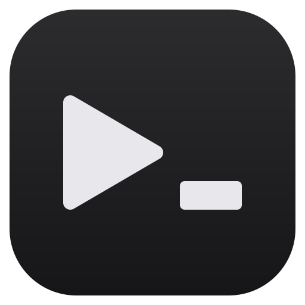
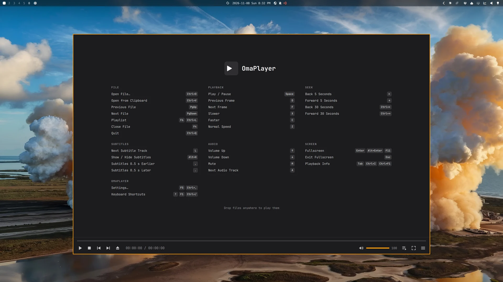
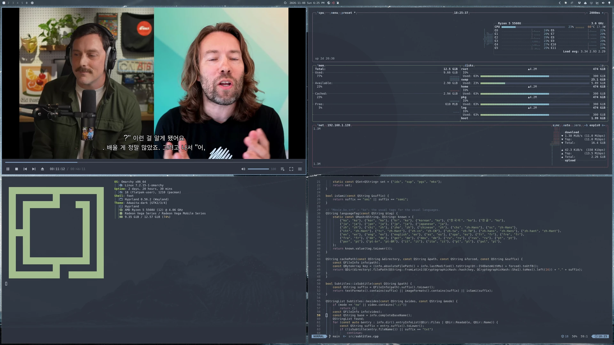
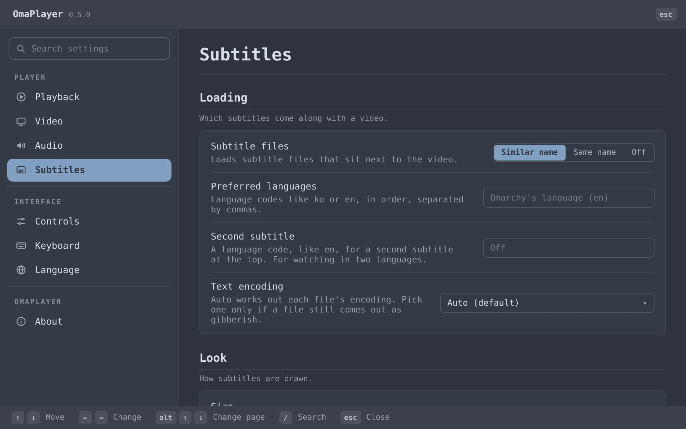
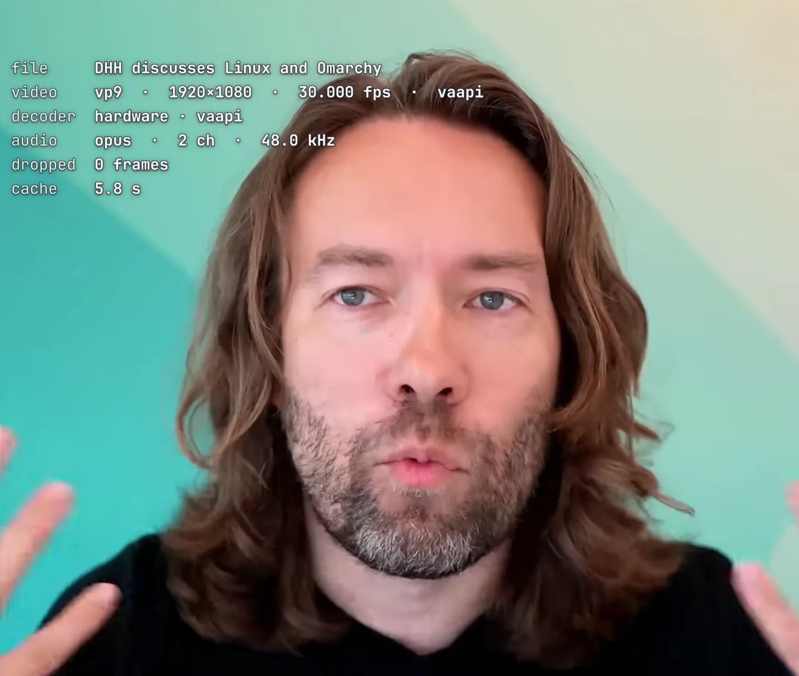
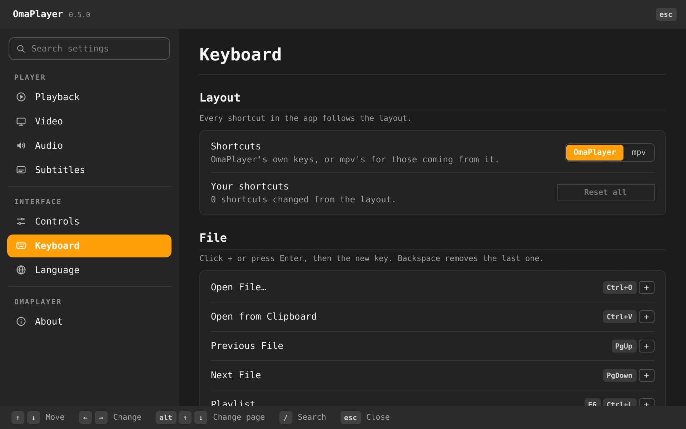
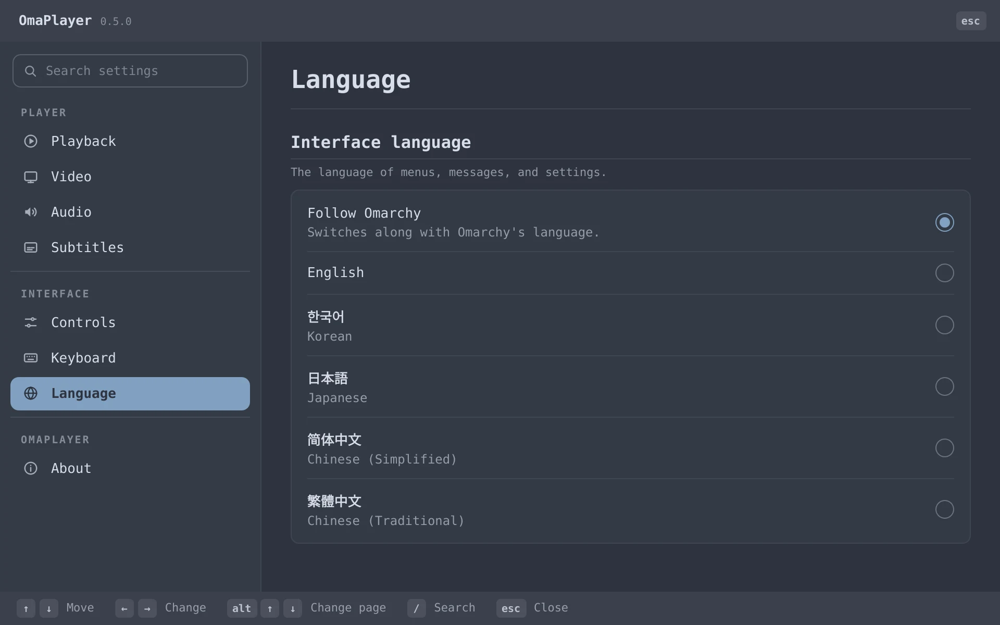

<div align="center">



# OmaPlayer
<br> <br>
<picture>
  <source media="(prefers-color-scheme: dark)" srcset="docs/hero-dark.svg">
  
</picture>

<br><br>



<br><br>

<a href="https://github.com/verified-human-42/omaplayer/releases/download/v1.0.0/omaplayer-demo.mp4"></a>

<b> Highlights. The full demo, with sound (72 s) <br> <a href="https://github.com/verified-human-42/omaplayer/releases/download/v1.0.0/omaplayer-demo.mp4">omaplayer-demo.mp4</a> </b>

</div>

## Why OmaPlayer

Haruna and Celluloid are decent, but they don't look like Omarchy. Plain mpv is
fast but bare. And PotPlayer, with the best interface and keys any player ever
had, doesn't run here.

**So OmaPlayer takes PotPlayer's hands, gives it Omarchy's face, and runs on mpv.**

- **Your hands already know it.** PotPlayer's keys, the right-click master menu,
  the docked bar, Tab for info, and the wheel for volume. The Linux classics
  (`Ctrl+,`, `Ctrl+Q`, `F11`) work too, and every key can be rebound.
- **The PotPlayer toolbox, minus the bloat.** A-B repeat, go to time,
  screenshots, brightness and contrast on the keyboard, audio sync, chapters,
  a second subtitle for learning languages, and one window for every file you
  open. No skins, no ads, no add-on store.
- **Your theme is the skin.** Every color comes from your Omarchy theme, and it
  changes the moment you switch themes. Clean, keyboard-first, no chrome to spare.
- **A citizen of the desktop.** Media keys, headphone buttons, and the Omarchy
  bar control it. `P` pops the video into a pinned corner while you work.
  `omarchy-update` keeps it current.
- **mpv speed, no compromise.** Hardware decoding, video drawn straight into the
  window, folder playlists, resume where you left off, and YouTube by URL.
- **Subtitles never come out garbled.** Any encoding, any language. See below.
- **Speaks your language:** English, 한국어, 日本語, 简体中文, 繁體中文.

<p align="center">
  
</p>

## Install

Copy and paste this into a terminal:

```sh
curl -fsSL https://raw.githubusercontent.com/verified-human-42/omaplayer/main/install.sh | bash
```

It installs the prebuilt package from the
[latest release](https://github.com/verified-human-42/omaplayer/releases/latest) with
pacman, so there's nothing to compile, and OmaPlayer shows up in the launcher.
`omarchy-update` keeps it up to date from then on; `sudo pacman -R omaplayer`
removes it. To compile instead,
add `-s -- --build` (the release) or `-s -- --git` (the latest from `main`).
It works the same on x86_64 and aarch64; the aarch64 build is for Omarchy's experimental
Apple M-series support (Asahi).

## Smart subtitles

Most subtitle files were saved on Windows in an old codepage, and players that
guess the encoding get them wrong. OmaPlayer reads each file and picks the
encoding whose text reads like real language: Korean, Japanese, Chinese,
Cyrillic, Greek, Hebrew, Arabic, Turkish, European, and more. It's tested on
70+ real lines down to a single word, with no hint.

- **Where PotPlayer slips.** On an English Windows, PotPlayer shows a Korean
  SMI saved in CP949 as gibberish, because it trusts the system codepage.
  OmaPlayer reads the text itself, whatever the system language.
- **SMI files get every language.** Korean and English classes become separate
  tracks instead of one jumbled track.
- **Stream captions in your language**, the site's own translations included.
- **Drop a subtitle on the window** to add it.

한글 자막 지원됩니다 · 日本語字幕に対応 · 支持简体中文字幕 · 支援繁體中文字幕

<p align="center">
  
</p>
<p align="center">
  
</p>
<p align="center">
  
</p>
<p align="center">
  
</p>

## Keys

<details>
<summary>The default layout (an mpv layout is one click away in Settings)</summary>

| | |
|---|---|
| `Space` | Play / pause |
| `←` `→` · `Ctrl+←` `Ctrl+→` · `Shift+←` `Shift+→` | Seek 5 s · 30 s · 1 min (adjustable) |
| `Backspace` · `Ctrl+Backspace` · `Shift+Backspace` | To the start · middle · 30 s before the end |
| `G` / `Ctrl+G` | Go to a time |
| `[` `]` · `\` | A-B repeat: start, end · off |
| `PgUp` `PgDn` · `Ctrl+PgUp` `Ctrl+PgDn` | Previous / next file · chapter |
| `D` `F` · `X` `C` `Z` | Frame back / forward · slower / faster / normal speed |
| `↑` `↓` · `M` · `A` | Volume · mute · next audio track |
| `<` `>` · `Shift+N` | Audio sync · even out loudness |
| `L` · `Alt+H` | Next subtitle · show or hide |
| `Home` `End` · `Ctrl+Home` | Previous / next subtitle line · replay this one |
| `,` `.` · `/` | Subtitles earlier / later · reset sync |
| `Alt+↑` `Alt+↓` · `Alt+PgUp` `Alt+PgDn` | Subtitles up / down · bigger / smaller |
| `W` `E` · `R` `T` · `Y` `U` · `I` `O` · `Q` | Brightness · contrast · saturation · hue · all off / back |
| `Ctrl+Enter` · `Ctrl+F6` · `Ctrl+Z` | Fill the screen · next aspect ratio · mirror |
| `Ctrl+E` / `K` · `Ctrl+C` | Save a screenshot · copy the frame |
| `Enter` / `Alt+Enter` / `F11` · `Esc` | Fullscreen · leave it |
| `Tab` · `P` | Playback info · picture in picture |
| `F6` / `Ctrl+L` | Playlist |
| `F5` / `Ctrl+,` | Settings |
| `Ctrl+O` · `Ctrl+V` · `Ctrl+Y` | Open a file · open from the clipboard · reopen the last file |
| `F4` · `Ctrl+Q` | Close the file · quit |
| `?` | Every shortcut |

Mouse: click to pause, double-click for fullscreen, wheel for volume,
right-click for the menu (pick a subtitle or audio track, an aspect ratio,
and every action above), and click the clock to show time remaining.

</details>

## Build

```sh
bin/build      # build/omaplayer
bin/test       # the test suite
bin/install    # install from this checkout
```

C++ and Qt Quick around libmpv. See [`AGENTS.md`](AGENTS.md) for how it fits together.

## License

GPL-3.0. Parts adapted from Omacut and Monologue are MIT; see [`NOTICE`](NOTICE).
Screenshots show [“DHH: Future of Programming, AI, Agentic Engineering, Vibe Coding & Linux”](https://www.youtube.com/watch?v=NYFGCESmikA)
(Lex Fridman Podcast #501), streamed from YouTube.
